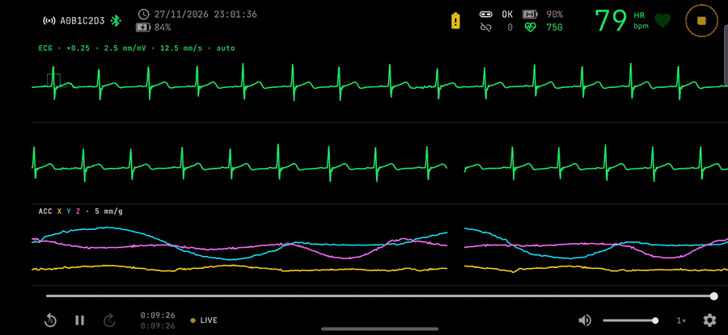
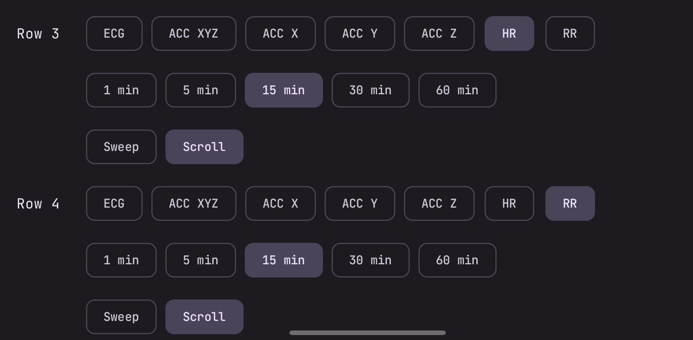
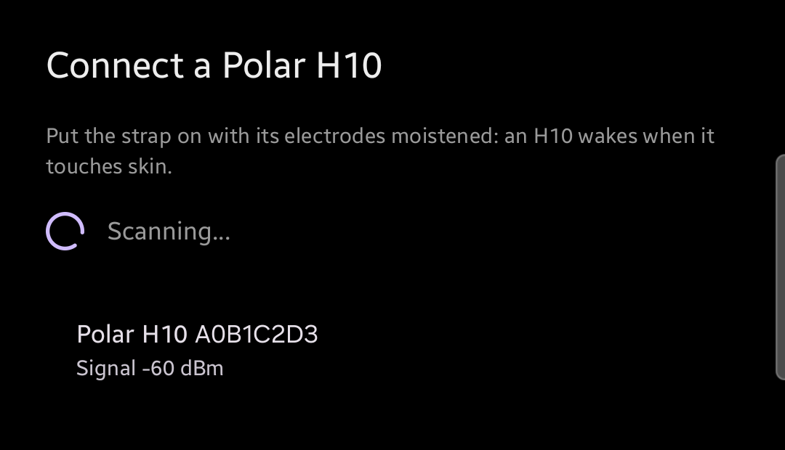

# Jabjotjai

<p align="center">
  
</p>

**A Holter-style recorder for a chest-strap ECG sensor.**

Android 13+ · No account · No internet access · Early prerelease

It records everything the strap sends, ECG, beat-to-beat (RR) intervals, heart rate and motion,
continuously, through exercise, sleep and everything in between, and keeps it, as received, on your
phone. It works with the Polar H10, and has only been tested on a Samsung Galaxy S25 with Android
17.

## Get the app

Download `jabjotjai-<version>.apk` from the
[latest release](https://github.com/benwrk/Jabjotjai/releases/latest), the newest on the list
while every release is still a prerelease, and open it on a phone running Android 13 or later. A newer version installs over an older one and keeps your recordings; never
uninstall to update, because uninstalling deletes them.

<table align="center">
  <tr>
    <td></td>
    <td></td>
    <td rowspan="2"></td>
  </tr>
  <tr>
    <td></td>
    <td></td>
  </tr>
</table>

## About this app

**Watch it live, like a bedside monitor**

- **ECG, motion and heart rate on one screen**: the ECG sweep, the accelerometer's X, Y and Z
  traces, the heart rate beside a heart that flashes at every beat the strap reports, and the last
  RR interval.
- **Read it the way a monitor is read**: sweep speed from 6.25 to 50 mm/s and ECG gain from ×0.25
  to ×4 of 10 mm/mV, or automatic scaling, with a 1 mV calibration pulse that follows both. The
  gain is one per signal, so every ECG row is drawn to the same scale and rows compare directly.
- **Lay out the chart as you need it**: up to six rows, each showing ECG, the accelerometer, a
  single axis, heart rate or RR intervals. A row can be a graph of its own, with its own speed,
  or join the row above into one taller graph, or cascade on from it into one long sweep, the way
  a bedside monitor folds a long ECG strip across its screen.
- **Heart-rate and RR trends**: rows that plot the values the strap reported across 1 to 60
  minutes, sweeping like the waveforms or scrolling with the newest value at the edge.
- **An optional beep at each beat**, with its own volume, in the foreground or in the background
  too.
- **Nothing is hidden by the display**: a peak that runs off the edge of its row is drawn on the
  edge and marked as clipped.
- **Landscape or portrait**, filling the screen either way.

**Rewind the recording while it is still running**

- **A timeline like a video player's**: pause, drag to any moment, jump 15 seconds back or
  forward, replay at 0.5× to 8×, and return to live with one tap.
- **The past is shown exactly as it was received**, read back from the recording itself.

**Keeps recording when you are not looking**

- **Runs in the background** until you stop it, with a notification showing heart rate, RR
  interval, connection, gaps, the strap's battery and skin contact. It is shown on the lock
  screen, and the app asks for it to be shown as a Live Update where the phone supports one.
- **Swiping the app away does not stop a recording.** After an app update the recording resumes
  by itself. If the app is stopped any other way, it offers to resume the recording the next time
  it is opened, and the time in between is kept as a gap.
- **Warns you about battery optimisation**, which can end an overnight recording, while it is
  switched on.

**Honest data**

- **Nothing is filtered, cleaned or downsampled.** Every sample is written to the phone as it
  arrives, so a crash costs seconds, not the night.
- **A dropout is recorded as a gap**, never stitched over, so it cannot pass for a real event.
- **Timestamps are kept as the strap delivered them**, alongside the phone's own clocks.
- **Plain, documented files**: one JSON object per line, described in
  [`docs/raw-format.md`](docs/raw-format.md).

> **Not a medical device.** Jabjotjai is not intended to diagnose, treat or monitor any medical
> condition, and must not be relied on for any medical decision. It is provided as is, without
> warranty or guarantee of any kind. See [`LICENSE`](LICENSE).

## What's new

- **Heart-rate and RR rows**, plotting the strap's values across 1 to 60 minutes.
- **Rows with their own speeds**: a row can be a separate graph at its own sweep speed, so the
  same ECG can be shown fast and slow at once.

Each release's notes, generated from its changes, are on the
[Releases](https://github.com/benwrk/Jabjotjai/releases) page.

## Data safety

- **No data collected, no data shared.** The app does not request internet access, and there is
  no account.
- **Recordings stay on your phone**, in the app's private storage, and are excluded from Android's
  cloud backup.
- **Uninstalling deletes every recording.** There is no export yet (see below), so keep the app
  installed and update it in place.

## App info

| | |
| --- | --- |
| Version | An early prerelease; see the [latest release](https://github.com/benwrk/Jabjotjai/releases/latest) |
| Requires | Android 13 or later, and a Polar H10 chest strap |
| Tested on | Samsung Galaxy S25, Android 17, One UI 9.0 |
| Install | The APK from [Releases](https://github.com/benwrk/Jabjotjai/releases): `jabjotjai-<version>.apk` is the release build, `jabjotjai-<version>-debug.apk` the debug build of the same commit |

Every build is signed with the same key, so a newer version installs over an older one and keeps
your recordings.

**Permissions**

| Permission                          | Why                                                           |
| ----------------------------------- | ------------------------------------------------------------- |
| Nearby devices (Bluetooth)          | Finding and connecting to the strap. Never used for location. |
| Notifications                       | The recording's notification, shown while it runs.            |
| Foreground service, wake lock       | Keeping the recording running with the screen off.            |
| Companion device presence, background running | Declared by a library the app includes; the app's own code does not use them. |

**Not there yet**

- **No list of past recordings, no viewer and no export.** Recordings are kept in the app's private
  storage, and nothing can get them off the phone yet.
- **No guided setup** for exempting the app from battery management.
- **No beat detection of its own.** The flash and the beep follow the beats the strap reports.

What each version does is in [`docs/spec.md`](docs/spec.md).

Jabjotjai is not affiliated with, endorsed by or sponsored by Polar Electro Oy. Polar and Polar
product names are trademarks of Polar Electro Oy.

---

## Building from source

Open the project in Android Studio (the project JDK is its bundled JBR 25), or build with
`./gradlew assembleDebug`.

Every build is signed with one key, named by four properties in `gradle.properties` in your Gradle
user home (`~/.gradle` unless `GRADLE_USER_HOME` is set):

```properties
jabjotjaiSigningStoreFile=/path/to/your.keystore
jabjotjaiSigningStorePassword=...
jabjotjaiSigningKeyAlias=...
jabjotjaiSigningKeyPassword=...
```

The build stops if any is missing, rather than signing with another key. A build signed with your
own key will not install over one from Releases. See decision
[`0010`](docs/decisions/0010-every-build-is-signed-with-one-stable-key.md).

After cloning, run `git config core.hooksPath .githooks` once. The hook keeps commit subjects in
the form `type(scope): description`, which the release notes are generated from.

## Releases

CI builds, tests and lints every push to master and every pull request, and checks that both APKs
are signed with the project's key. To release, set `appVersion` in `app/build.gradle.kts`, push
master, and once its CI run has finished, push a tag `vMAJOR.MINOR.PATCH` on that commit. CI then
drafts a GitHub Release with both APKs and notes generated from the commit subjects since the
previous tag. See [`.github/workflows/ci.yml`](.github/workflows/ci.yml) and decisions
[`0011`](docs/decisions/0011-ci-checks-every-change-and-drafts-a-release-from-version-tags.md) and
[`0012`](docs/decisions/0012-release-notes-are-generated-from-commit-subjects.md).

## Documentation

| Where                                      | What                                                           |
| ------------------------------------------ | -------------------------------------------------------------- |
| [`AGENTS.md`](AGENTS.md)                   | The principles every change follows, and how work is done here |
| [`docs/spec.md`](docs/spec.md)             | What the app does, version by version                          |
| [`docs/raw-format.md`](docs/raw-format.md) | The recording file format, every schema                        |
| [`docs/decisions/`](docs/decisions/)       | Each decision, and the options it rejected                     |
| [`docs/backlog.md`](docs/backlog.md)       | Work known to be outstanding                                   |

## License

All rights reserved. The source is public so that it can be read, but it is not licensed for
reuse: copying, modifying or redistributing it needs written permission. You may install and run
the APKs published on the Releases page on your own devices, for your own use. The software is
provided as is, without warranty or guarantee, and is not a medical device. The full terms are in
[`LICENSE`](LICENSE).

The app includes third-party software, including Polar's SDK, each under its own licence. They are
listed, with their licence texts, in [`THIRD_PARTY_NOTICES.md`](THIRD_PARTY_NOTICES.md), which is
also attached to every release. The list is generated from the build's dependencies by
[`scripts/third-party-notices.sh`](scripts/third-party-notices.sh), and CI fails if it falls out of
date.
