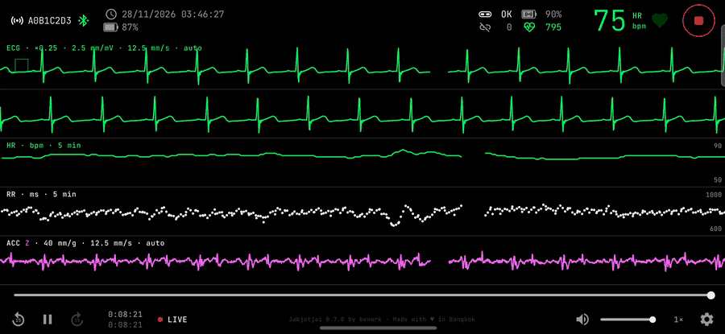
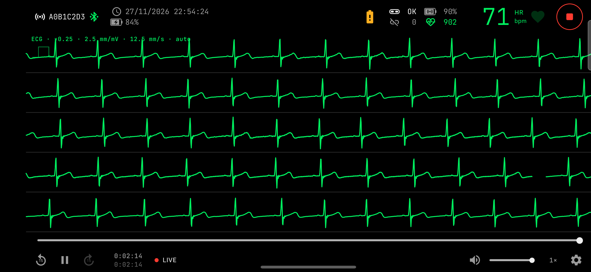
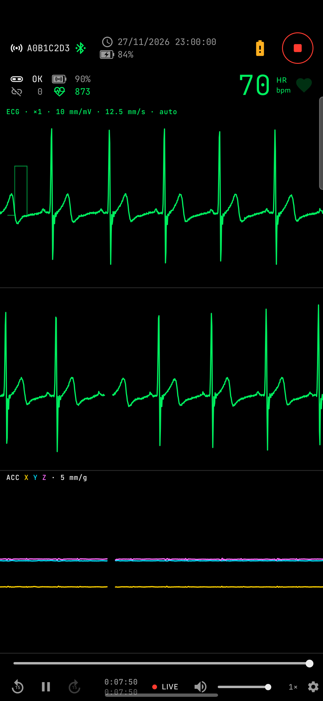

# Jabjotjai

**Record ECG, heart rate and motion from a Polar H10, day and night.**

Jabjotjai turns a Polar H10 chest strap into a Holter-style recorder. It captures everything the
strap sends, ECG, beat-to-beat (RR) intervals, heart rate and motion, continuously, through
exercise, sleep and everything in between, and keeps it, as received, on your phone.

<p align="center">
  
</p>

### Watch it live, like a bedside monitor

- **ECG, motion and heart rate on one screen**: the ECG sweep, the accelerometer's X, Y and Z
  traces, the heart rate beside a heart that flashes at every beat the strap reports, and the last
  RR interval.
- **Read it the way a monitor is read**: sweep speed from 6.25 to 50 mm/s and ECG gain from ×0.25
  to ×4 of 10 mm/mV, or automatic scaling, with a 1 mV calibration pulse that follows both.
- **Lay out the chart as you need it**: up to six rows, each showing ECG, the accelerometer or a
  single axis. Neighbouring rows of one signal join into one taller graph, or cascade into one
  long sweep, the way a bedside monitor folds a long ECG strip across its screen.
- **An optional beep at each beat**, with its own volume, in the foreground or in the background
  too.
- **Nothing is hidden by the display**: a peak that runs off the edge of its row is drawn on the
  edge and marked as clipped.
- **Landscape or portrait**, filling the screen either way.

<p align="center">
  
</p>

### Rewind the capture while it is still recording

- **A timeline like a video player's**: pause, drag to any moment, jump 15 seconds back or
  forward, replay at 0.5× to 8×, and return to live with one tap.
- **The past is shown exactly as it was received**, read back from the recording itself.

<p align="center">
  
</p>

### Keeps recording when you are not looking

- **Runs in the background** until you stop it, with a notification showing heart rate, RR
  interval, connection, gaps, the strap's battery and skin contact. It is shown on the lock
  screen, and the app asks for it to be shown as a Live Update where the phone supports one.
- **Swiping the app away does not stop a recording.** After an app update the recording resumes
  by itself. If the app is stopped any other way, it offers to resume the recording the next time
  it is opened, and the time in between is kept as a gap.
- **Warns you about battery optimisation**, which can end an overnight recording, while it is
  switched on.

### Honest data

- **Nothing is filtered, cleaned or downsampled.** Every sample is written to the phone as it
  arrives, so a crash costs seconds, not the night.
- **A dropout is recorded as a gap**, never stitched over, so it cannot pass for a real event.
- **Timestamps are kept as the strap delivered them**, alongside the phone's own clocks.
- **Plain, documented files**: one JSON object per line, described in
  [`docs/raw-format.md`](docs/raw-format.md).

### Private

- **No account and no cloud.** Recordings stay on the phone, and are excluded from Android's cloud
  backup.

<table align="center">
  <tr>
    <td rowspan="2"></td>
    <td></td>
  </tr>
  <tr>
    <td></td>
  </tr>
</table>

> **Not a medical device.** Jabjotjai is not intended for diagnosis, treatment or monitoring of
> any medical condition.

## Status

Version 0.4.0, an early prerelease. What each version does is in [`docs/spec.md`](docs/spec.md).

Not there yet:

- **No list of past recordings, no viewer and no export.** Recordings are kept in the app's private
  storage, and nothing can get them off the phone yet.
- **No guided setup** for exempting the app from battery management.
- **No beat detection of its own.** The flash and the beep follow the beats the strap reports.

## Requirements

- A Polar H10 chest strap.
- An Android phone running Android 13 or later. It is tested on a Samsung Galaxy S25 with
  Android 17 and One UI 9.0.

## Install

Download the APK from [Releases](https://github.com/benwrk/Jabjotjai/releases):
`jabjotjai-<version>.apk` is the release build, and `jabjotjai-<version>-debug.apk` the debug
build of the same commit.

Every build is signed with the same key, so a newer version installs over an older one and keeps
your recordings. **Do not uninstall the app to update it**: uninstalling deletes every recording
on the phone.

The app uses:

| Permission                         | Why                                                        |
| ---------------------------------- | ---------------------------------------------------------- |
| Nearby devices (Bluetooth)         | Finding and connecting to the strap. Never used for location. |
| Notifications                      | The recording's notification, shown while it runs.          |
| Foreground service, wake lock      | Keeping the recording running with the screen off.         |

## Building from source

Open the project in Android Studio (the project JDK is its bundled JBR 25), or build with
`./gradlew assembleDebug`.

Every build is signed with one key, named by four properties in `gradle.properties` in your Gradle
user home (`~/.gradle` unless `GRADLE_USER_HOME` is set):

```properties
jabjotjaiSigningStoreFile=/path/to/your.keystore
jabjotjaiSigningStorePassword=...
jabjotjaiSigningKeyAlias=...
jabjotjaiSigningKeyPassword=...
```

The build stops if any is missing, rather than signing with another key. A build signed with your
own key will not install over one from Releases. See decision
[`0010`](docs/decisions/0010-every-build-is-signed-with-one-stable-key.md).

After cloning, run `git config core.hooksPath .githooks` once. The hook keeps commit subjects in
the form `type(scope): description`, which the release notes are generated from.

## Releases

CI builds, tests and lints every push to master and every pull request, and checks that both APKs
are signed with the project's key. To release, set `appVersion` in `app/build.gradle.kts`, push
master, and once its CI run has finished, push a tag `vMAJOR.MINOR.PATCH` on that commit. CI then
drafts a GitHub Release with both APKs and notes generated from the commit subjects since the
previous tag. See [`.github/workflows/ci.yml`](.github/workflows/ci.yml) and decisions
[`0011`](docs/decisions/0011-ci-checks-every-change-and-drafts-a-release-from-version-tags.md) and
[`0012`](docs/decisions/0012-release-notes-are-generated-from-commit-subjects.md).

## Documentation

| Where                                    | What                                                        |
| ---------------------------------------- | ----------------------------------------------------------- |
| [`AGENTS.md`](AGENTS.md)                 | The principles every change follows, and how work is done here |
| [`docs/spec.md`](docs/spec.md)           | What the app does, version by version                       |
| [`docs/raw-format.md`](docs/raw-format.md) | The recording file format, every schema                   |
| [`docs/decisions/`](docs/decisions/)     | Each decision, and the options it rejected                  |
| [`docs/backlog.md`](docs/backlog.md)     | Work known to be outstanding                                |
